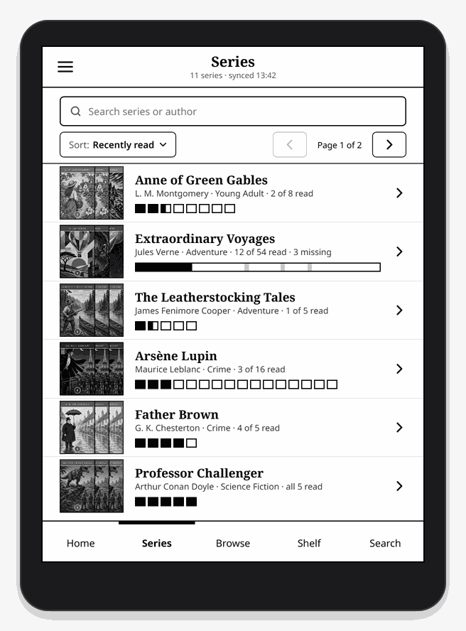
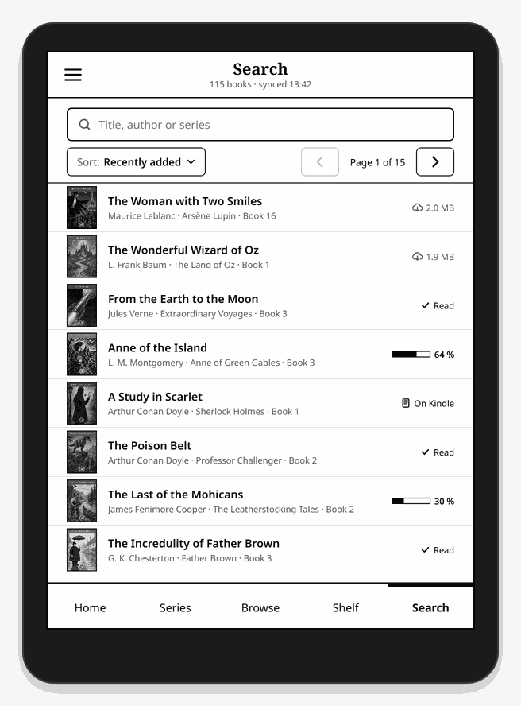
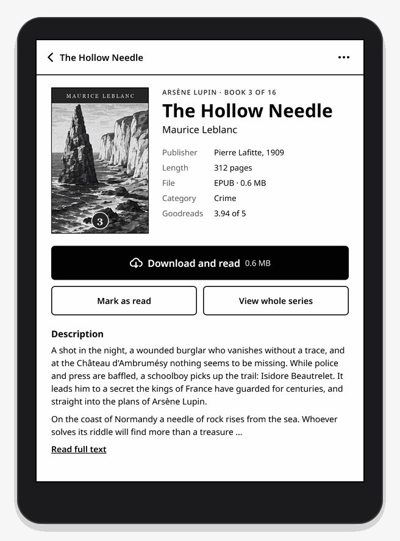

# Grimmory for KOReader

[](https://github.com/rolschewsky/grimmory-ui.koplugin/releases/latest)
[](LICENSE)
[](https://github.com/rolschewsky/grimmory-ui.koplugin/actions/workflows/release.yml)
[](https://koreader.rocks)
[](#translations)

Your [Grimmory](https://github.com/grimmory-tools/grimmory) library on your e-reader. This
[KOReader](https://koreader.rocks) plugin turns a Kindle or Kobo into a window onto your self-hosted
ebook server: browse your series, discover something random, search the whole collection, tap a
book, and it downloads and opens in KOReader. When you close the book, you are back in your library.

It is built for E-Ink from the ground up: pages instead of scrolling, large tap targets, no
animations, black and white with 16 shades of grey, and the same physical size on every screen,
from a 2009 Kindle 2 to a Kobo Libra Colour.

|  |  |  |
|:-:|:-:|:-:|
| **Home** · pick up where you left off | **Series** · every volume at a glance | **Browse** · let chance choose |
|  |  |  |
| **Shelf** · in colour on Kobo | **Search** · title, author, series | **Book** · tap to download and read |

## What you get

| Section | What it shows |
|---|---|
| **Home** | A greeting for the time of day, your server and when it last synced. Continue reading, four random books, the four most recently added. |
| **Series** | Every series with its reading state per volume (read, in progress, unread, missing from Grimmory); long series become a progress bar. Sorted by last read, last viewed or name; the choice is remembered. |
| **Browse** | A random series, a random book with its blurb, and three random genres as tabs. Shuffle for new picks. |
| **Shelf** | The whole library as a cover grid. Filter by genre and sort by date added, title, author, series, last read, last viewed or at random (the default); both choices are remembered. |
| **Search** | Title, author and series search with filters for in progress, unread, read and on this device. Sorted like the Shelf or by size, at random by default; the choice is remembered. |

From the menu you can sync, see what is stored on the device and free up space book by book,
open the settings, check for updates, show a QR code to star the project on GitHub, or go back
to KOReader's file manager. After your third book read through the plugin, a small box in the
corner asks once for a star; "Later" asks one more time after 30 days. It only counts on the
device and sends nothing.

- **One tap to read.** Books download on demand and open in KOReader's reader. Missing volumes of a
  series download in one go.
- **Reading state both ways.** Progress from KOReader is reported back to Grimmory, so your other
  devices and the web app know where you are.
- **Opens instead of the file manager.** Optional: the plugin becomes your home screen when
  KOReader starts and after every book you close.
- **Next volume at the end.** When you finish a book from Grimmory, a dialog marks it as read and
  offers the next volume of the series.
- **Syncs in the background.** You keep browsing while the library syncs; the header shows how
  it is going.
- **Recently viewed.** Shelf, Search and Series can sort by what you looked at last. This is only
  remembered on the device.
- **Works behind a reverse proxy.** Add any number of extra headers (an API key for your proxy,
  for example), sent with every request.
- **Keeps the device tidy.** Finished books can be removed automatically after a number of days.
- **15 languages.** English, German, French, Spanish, Italian, Portuguese, Polish, Romanian, Dutch,
  Greek, Simplified Chinese, Japanese, Hindi, Bengali and Indonesian. The plugin follows
  KOReader's language setting and falls back to English; Menu › Language picks a language for the
  plugin alone.

<p align="center"></p>

## Installation

**With Storefront or the AppStore:** install
[Storefront](https://github.com/ultimatejimmy/storefront.koplugin) or
[appstore.koplugin](https://github.com/omer-faruq/appstore.koplugin), search for "grimmory-ui" and
install. Updates come the same way.

**By hand:** download `grimmory-ui.koplugin-vX.Y.Z.zip` from the
[releases](../../releases), copy the folder `grimmory-ui.koplugin` into `koreader/plugins/` on your
device and restart KOReader.

The plugin can also update itself without a computer: Menu › About Grimmory checks this
repository for a new release. A fork can enter its own repository under Settings › Updates.

This plugin is not [Grimmory Sync](https://github.com/grimmory-tools/grimmory.koplugin), the
official plugin that syncs reading progress. Both can be installed side by side.

**Coming from version 1.0.0?** It was installed as `grimmory.koplugin`. Delete that folder from
`koreader/plugins/` after installing this one; your settings and library are taken over on the
first start.

## Setup

Open the menu at the top left, then **Settings**:

- **Server:** address (for example `https://grimmory.example.com`), user and password.
- **Extra headers:** sent with every request, for example a key for a reverse proxy in front of
  Grimmory.
- **Test** signs in and fetches the book list, so you see right away whether everything works.
- **Sync:** automatically on open when the last sync is older than 30 minutes and Wi-Fi is on,
  report reading status to Grimmory, preload covers.
- **Formats:** only books in the formats switched on here are synced, EPUB and MOBI by default.
  Every format on your server is listed with its number of books.
- **Books:** download folder, remove finished books after a number of days.
- **Display:** the section the plugin opens with, and whether it opens instead of the file
  manager.

In Grimmory, the user needs the permissions **Download Books** and **KOReader Sync**. A separate
account for the e-reader works best.

To sync reading progress page by page between several devices, you can additionally point
KOReader's progress sync at your Grimmory server (`…/api/koreader`).

## Home screen behaviour

With **Open instead of the file manager** (on by default) the plugin covers the file manager when
KOReader starts and every time you close a book. Switched off, it still comes back after books
from Grimmory. **Back to KOReader** in the menu shows the file manager. Grimmory is the first entry
under Tools in KOReader's menu, and you can bind a gesture to the action **Open Grimmory**.

At the end of a book from Grimmory, the plugin shows its own dialog instead of KOReader's
question: mark the book as read, read the next volume of the series, go back to the library or
stay in the book. **More options from KOReader** shows KOReader's question. If you chose another
end-of-book action in KOReader, that one stays.

## Sync in the background

The sync runs in a separate process, so the plugin stays usable. The header shows "Syncing …",
then the number of new books. If the sync fails, a warning appears in the header; tap it for the
reason. The plugin never switches Wi-Fi on for an automatic sync. While the e-reader sleeps,
nothing runs: there is no background service outside KOReader.

## Security

- Every HTTPS connection verifies the certificate chain against KOReader's CA bundle and checks
  the host name. KOReader itself does neither for plugin requests.
- Password, tokens and header values are stored only in `koreader/settings/grimmory-ui.lua` on the
  device and never written to a log. They are not encrypted there, so give the e-reader its own
  account with only the permissions above, and revoke that account and any proxy key if the
  device gets lost.
- The plugin does not follow redirects, so headers and tokens never reach another host. Use an
  `https://` address: with `http://`, password and token travel in plain text.

## Status of version 1.0

- Touch devices are fully supported. Devices without a touchscreen (Kindle 2 and older) can turn
  pages and go back; selecting single items with the five-way controller is not there yet.
- Automatic sync runs when you open the plugin with Wi-Fi on. There is no schedule.
- Downloads show a message but no progress bar yet.

## Translations

Texts live in `grimmory-ui.koplugin/grimmoryui/l10n/<language>.lua`. The keys are the German texts from
the code, `en.lua` holds every key with its English text. To add or improve a language:

1. Copy `en.lua` to the KOReader language code, for example `sv.lua` or `pt_BR.lua`.
2. Translate the values. Keep `%1`, `%2` … (their order may change). Plural entries are lists with
   one form per plural category of the language; if it needs a rule other than "one / other",
   add it to `PLURAL` in `grimmoryui/i18n.lua`.
3. Run the checks below and open a pull request.

## Development

```sh
luajit tests/test_logic.lua   # API helpers, sync, queries, version compare, without KOReader
luajit tests/check_l10n.lua   # every language: complete, placeholders, plural forms
```

On a Kindle, `luajit` is in `/mnt/us/koreader/`.

A release is made by pushing a tag `vX.Y.Z`. The version must already be in
`grimmory-ui.koplugin/_meta.lua`. The workflow runs the tests, builds
`grimmory-ui.koplugin-vX.Y.Z.zip` and creates the GitHub release.

## License

[Mozilla Public License 2.0](LICENSE). You may use, change and share the plugin, also as part of a
larger work. Changes to its files stay under the MPL and have to be shared as source code.
